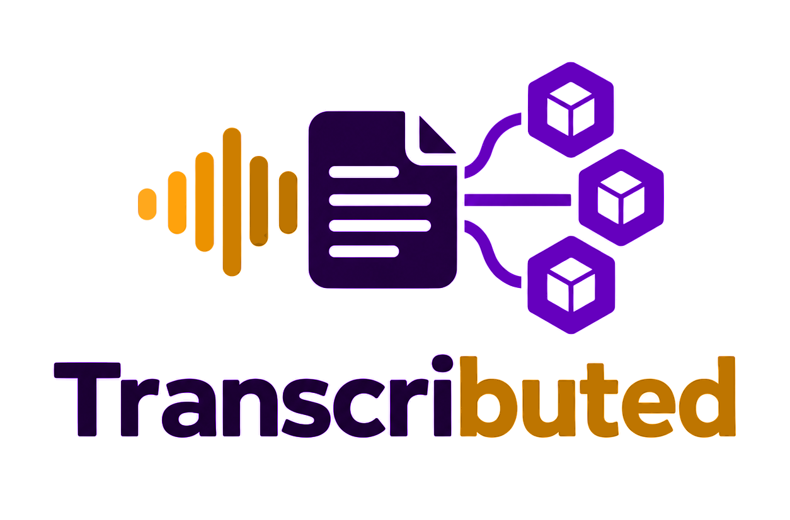
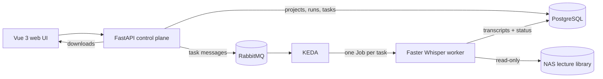

<p align="center">
  
</p>

<h1 align="center">Transcributed</h1>

<p align="center"><b>Your lectures, transcribed on your own hardware.</b></p>

<p align="center">
  
  
  
  
  
  
</p>

**Transcributed is a self-hosted lecture transcription system that turns recordings stored on a NAS into clean, downloadable text.**

Create a project, pick the lectures you want, and start a run. Transcributed snapshots the project, queues one task per lecture, and lets workers transcribe them with Faster Whisper — no uploads, no cloud service, no manual file shuffling.

> **Pick → Queue → Transcribe → Download.** Your media stays on the NAS; the transcripts come back through the API and web UI.

## Features

- **Project-based lecture lists** — save a course as a project, browse the NAS, and add the files you want.
- **One task per lecture** — each recording is an isolated queue message and worker Job.
- **Queue-driven scaling** — KEDA creates a worker Job for each queued lecture.
- **Multiple output formats** — plain text, WebVTT, JSON with timed segments, and metadata.
- **Optional timestamps in TXT** — prefix every line with its source time range.
- **Language control** — automatic detection or explicit English, Russian, or German.
- **Live progress** — follow runs and tasks, inspect active workers, and cancel work you no longer need.
- **Read-only NAS input** — recordings are never copied or modified by Transcributed.
- **Transcripts in PostgreSQL** — small, transactional, backed up with the database, and downloadable through the API.

## How it works



1. **Create a project** — add NAS-relative paths to the lecture files you want to transcribe.
2. **Start a run** — the API snapshots the project defaults and creates one task per included lecture.
3. **Queue the work** — each task is published to RabbitMQ; KEDA creates a worker Job when the queue is not empty.
4. **Transcribe** — the worker reads the recording with `ffmpeg` and runs Faster Whisper on CPU using INT8 quantization.
5. **Collect the result** — transcripts are stored in PostgreSQL, progress is exposed through the API, and the UI offers downloads when a task succeeds.

## Tech stack

| Layer | Technology |
| --- | --- |
| API | Python 3.14, FastAPI, Pydantic, SQLAlchemy (async), Alembic |
| Worker | Faster Whisper, ffmpeg, NumPy |
| Queue | RabbitMQ |
| Orchestration | Kubernetes Jobs, KEDA `ScaledJob` |
| Storage | PostgreSQL |
| Web UI | Vue 3, TypeScript, Vite, Tailwind CSS |
| Tooling | uv, pytest, ruff, mypy |

## Getting started

**Requirements:** Python 3.14, [uv](https://docs.astral.sh/uv/), Docker, and Node.js 24 for the UI. The worker needs `ffmpeg`; the worker container includes it.

```bash
git clone git@github.com:rykhalskyi/transcributed.git
cd transcributed
```

### API and local infrastructure

```bash
cd api
cp .env.example .env
uv sync --extra worker

# Start PostgreSQL and RabbitMQ
docker compose -f ../docker-compose.dev.yml up -d postgres rabbitmq

# Apply the schema and run the API
uv run alembic upgrade head
uv run transcributed
```

The API is available at `http://localhost:8000`, with Swagger UI at `http://localhost:8000/docs`. Health checks live at `/healthz` and `/readyz`.

### Worker

Run one worker iteration directly:

```bash
cd api
uv run transcributed-worker
```

Or use the container, which already contains `ffmpeg` and the Whisper model:

```bash
docker compose -f docker-compose.dev.yml --profile worker run --rm worker
```

By default the worker looks for input under `api/samples`. Point `NAS_INPUT_ROOT` at your lecture library, or place files in `api/samples/` for a local test.

### Web UI

```bash
cd ui
npm ci
echo 'VITE_API_PROXY_TARGET=http://localhost:8000' > .env.local
npm run dev
```

The dev server listens on `http://localhost:5173` and proxies API requests to the configured backend.

### Full local stack

```bash
docker compose -f docker-compose.dev.yml --profile app up -d --build
docker compose -f docker-compose.dev.yml --profile worker run --rm worker
```

`scripts/e2e-local.sh` runs the complete API → queue → worker path against a sample lecture.

### Tests and checks

```bash
cd api
uv run pytest
uv run ruff check .
uv run mypy src tests
```

```bash
cd ui
npm run typecheck
npm run build
```

## Project structure

```text
api/                 # FastAPI control plane, Faster Whisper worker, migrations, tests
ui/                  # Vue 3 single-page app
scripts/             # local end-to-end and release helpers
wiki/                # design notes, decisions, and the operations runbook
docker-compose.dev.yml
```

## Configuration

Settings live in `api/.env` (see `api/.env.example`). The most important values:

| Variable | Purpose |
| --- | --- |
| `DATABASE_URL` | PostgreSQL connection string |
| `RABBITMQ_URL` | RabbitMQ connection string |
| `NAS_INPUT_ROOT` | Root directory for lecture files |
| `WHISPER_MODEL` | Whisper model to use (`small` in the container image) |
| `WHISPER_DEVICE` / `WHISPER_COMPUTE_TYPE` | Default `cpu` / `int8` |
| `WHISPER_LOCAL_FILES_ONLY` | Prevent runtime model downloads |

## Status

Transcributed is a homelab project. The API is meant for a trusted network: authentication and multi-user authorization are not implemented yet.

## License

[MIT](LICENSE) © 2026 rykhalskyi
